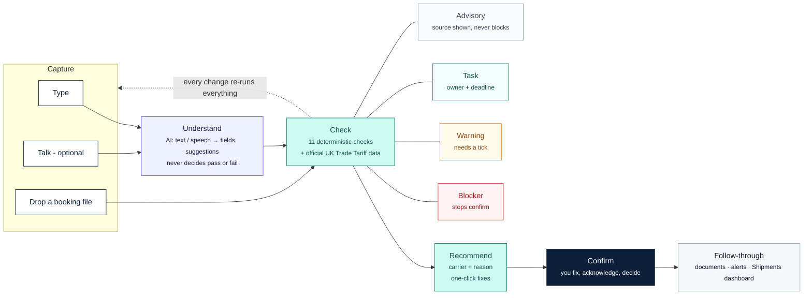
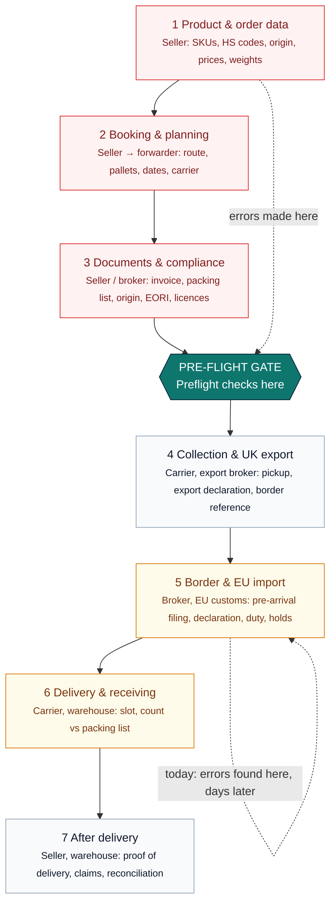

# Preflight — diagrams (Mermaid)

## (a) The pre-flight loop

**Roles:** AI understands · Rules check · You decide. Files go straight to Check (no AI needed to read a structured sheet).

## (b) Where Preflight sits in the value chain

**Reading it:** Preflight works in layers 1–3 and at the gate before collection. It doesn't move goods, file declarations or pay duty (layers 4–5); it hands carriers and brokers clean data so the holds in layers 5–6 don't happen.
